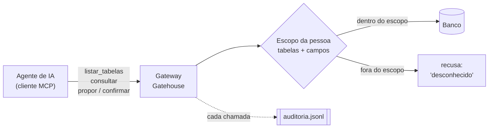
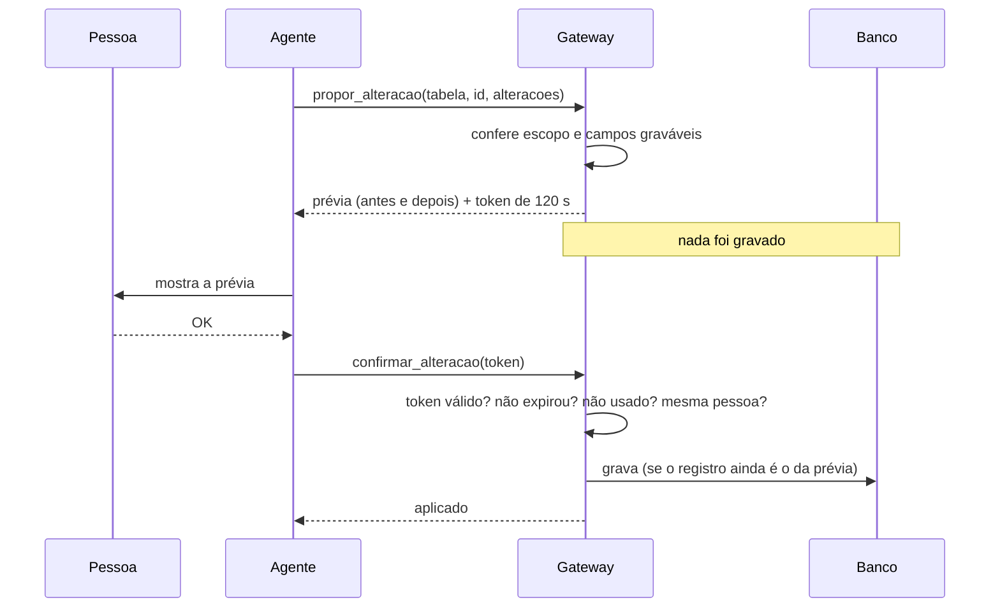

<p align="center">
  
</p>

<p align="center">
  <a href="https://github.com/Dimasaas/gatehouse/actions/workflows/ci.yml"></a>
  
  
  
  
</p>

# Gatehouse

> gateway MCP de leitura com escopo por pessoa, escrita em 2 etapas e auditoria

Um gateway [MCP](https://modelcontextprotocol.io) (servidor stdio) que dá a um agente de IA acesso **de leitura** a um banco, **com permissão por pessoa**. Quem decide o que o agente enxerga é um arquivo de escopos, não o agente. Escrever é possível, mas só em duas etapas: o agente **propõe**, a pessoa **vê a prévia e dá o OK**.

O banco do projeto é fictício e fica em memória (uma loja de exemplo: clientes inventados com e-mails `@example.com`, pedidos e produtos), então dá para rodar tudo sem credencial nenhuma.

## Por que existe

Quase todo mundo quer o mesmo: *"deixa a IA olhar a produção para responder perguntas"*. O caminho mais curto é entregar uma conexão de banco ao agente, e isso é entregar a chave da casa: SQL livre lê qualquer tabela, qualquer coluna, sem limite, e um erro de interpretação do modelo vira um `UPDATE` sem `WHERE`.

O Gatehouse fica no meio e muda o contrato:

- o agente **não escreve SQL**: usa uma DSL pequena (`tabela`, `campos`, `filtros`, `limite`);
- cada pessoa tem um **escopo**: quais tabelas e quais campos. O que está fora **nem aparece no esquema**;
- o **limite tem teto**, definido por quem administra, não por quem pergunta;
- **escrever exige duas chamadas** e um token de vida curta, preso à pessoa e de uso único;
- **toda chamada deixa uma linha de auditoria**, sem os valores sensíveis.

## Como funciona



A escrita em duas etapas:



### Ferramentas

| Ferramenta | O que faz |
|---|---|
| `listar_tabelas` | Tabelas e campos que o **seu** escopo enxerga, com o tipo de cada campo e quais são graváveis. |
| `consultar` | Leitura por DSL: `tabela`, `campos`, `filtros` (`=`, `!=`, `>`, `<`, `contem`, combinados com E) e `limite` (reduzido ao teto). **Não aceita SQL.** |
| `propor_alteracao` | Etapa 1. Valida o escopo e devolve a prévia (antes e depois) e um token. **Não grava.** |
| `confirmar_alteracao` | Etapa 2. Só executa se o token for válido, não tiver expirado, não tiver sido usado e vier da mesma pessoa. |

## Uso

```bash
git clone https://github.com/Dimasaas/gatehouse.git
cd gatehouse
npm ci
npm test        # suíte com node:test
npm run demo    # imprime uma sessão completa
```

Cada processo serve **uma pessoa**, definida na subida por variável de ambiente. A identidade nunca vem do agente:

| Variável | Para quê | Padrão |
|---|---|---|
| `MCP_PESSOA` | Pessoa cujo escopo vale neste processo (obrigatória) | — |
| `MCP_ESCOPOS` | Arquivo de escopos | `exemplos/escopos.json` |
| `MCP_DADOS` | Dados do banco fictício | `exemplos/dados.json` |
| `MCP_AUDITORIA` | Arquivo JSONL de auditoria | `./auditoria.jsonl` |

Para um cliente MCP (ex.: Claude Desktop), veja [`exemplos/claude_desktop_config.json`](exemplos/claude_desktop_config.json): um servidor por pessoa, cada um com o seu `MCP_PESSOA`.

### Escopos

```jsonc
{
  "limite_padrao": 10,            // linhas quando o agente não pede um limite
  "limite_maximo": 20,            // teto: nenhum pedido passa disso
  "validade_token_segundos": 120, // vida do token de confirmação
  "pessoas": {
    "ana_atendimento": {
      "tabelas": {
        "clientes": { "campos": ["id", "nome", "email", "cidade"] },   // 'observacao_interna' não existe para ela
        "pedidos": {
          "campos": ["id", "cliente_id", "total", "status"],
          "gravaveis": ["status"]                                       // só este campo pode mudar
        }
      }
    }
  }
}
```

`gravaveis` precisa ser subconjunto de `campos`: a configuração é validada na subida (com `zod`) e recusada se um campo gravável não for visível.

### Uma sessão (trecho do `npm run demo`)

```text
[ana] consultar {"tabela":"clientes","campos":["nome","observacao_interna"]}
  RECUSADO -> campo_desconhecido: Campo desconhecido em clientes: observacao_interna

[ana] propor_alteracao {"tabela":"pedidos","id":1001,"alteracoes":{"status":"cancelado"}}
  {"token":"…","previa":{"antes":{"status":"pago"},"depois":{"status":"cancelado"}}, …}

[ana] confirmar_alteracao {"token":"…"}   ->  {"aplicado":true, …}
[ana] confirmar_alteracao {"token":"…"}   ->  RECUSADO -> token_ja_usado
```

### Auditoria

Uma linha JSONL por chamada: quem, o quê, quando, resultado. Guarda **nomes** de campos e contagens, nunca valores de filtro, de alteração, linhas devolvidas nem o token (só um identificador curto que liga a proposta à confirmação):

```json
{"ts":"2026-11-25T20:33:09.123Z","pessoa":"ana_atendimento","ferramenta":"consultar","entrada":{"tabela":"clientes","campos":["id","nome","cidade"],"filtros":[{"campo":"cidade","op":"="}]},"resultado":"ok","linhas":1}
{"ts":"2026-11-25T20:33:09.140Z","pessoa":"ana_atendimento","ferramenta":"confirmar_alteracao","entrada":{"token_id":"b39ca58dcefb"},"resultado":"negado","codigo":"token_ja_usado"}
```

## Modelo de ameaças

| Ameaça | Como o desenho responde |
|---|---|
| Agente (ou injeção de prompt) tenta SQL livre | Não existe SQL: só a DSL, validada com `zod`. Chave desconhecida é ignorada, operador desconhecido é recusado. |
| Ler campo que não é seu | Campo e tabela fora do escopo recebem o **mesmo erro** de um nome inexistente; não aparecem no esquema. |
| Adivinhar valor oculto por filtro | Filtrar por campo fora do escopo é recusado como qualquer outro. |
| Despejar a tabela inteira | O limite é reduzido ao teto configurado. |
| Escrita sem o humano ver | Duas etapas: a prévia sai antes, e a gravação exige o token. |
| Token roubado, repetido ou velho | Preso à pessoa, de uso único, expira (120 s por padrão). Recusas ficam na auditoria. |
| Registro mudou entre a prévia e o OK | A confirmação compara o "antes" com o estado atual e recusa se divergiu. |
| Agente se passar por outra pessoa | A identidade é fixada na subida do processo; nenhuma ferramenta recebe "quem sou eu". |
| Vazar dado pela trilha de auditoria | A trilha só guarda nomes de campos, contagens e códigos. |

**Fora do escopo (limites honestos):** é um projeto de demonstração. O banco é em memória e os tokens pendentes também (reiniciar o processo os descarta); não há autenticação de quem inicia o processo (isso é do sistema operacional ou do orquestrador); o arquivo de auditoria não é à prova de adulteração; e o gateway não decide *se* a pessoa deveria dar o OK, só garante que ele aconteça.

## Estrutura

```text
src/
  gateway.js     regra central: escopo, auditoria, propor e confirmar
  consulta.js    DSL de consulta (zod) e filtros
  escrita.js     propostas e tokens (validade, dono, uso único)
  auditoria.js   trilha JSONL
  config.js      leitura e validação dos escopos
  banco.js       banco fictício em memória
  servidor.js    ferramentas MCP; index.js: processo stdio
exemplos/        dados.json, escopos.json, config de cliente MCP e demo
test/            node:test (escopo, campo oculto, limite, tokens, auditoria, servidor)
```

## Licença

[PolyForm Noncommercial 1.0.0](LICENSE). Uso livre para estudo, pesquisa e projetos pessoais ou sem fins comerciais; uso comercial só com autorização do autor.

## 🇺🇸 TL;DR

`Gatehouse` is a small MCP (stdio) gateway that gives an AI agent **read access** to a database **per person**, without handing over the keys. Scopes in a config file define which tables and fields each person sees (anything else is not even in the schema). Queries use a tiny DSL (`=`, `!=`, `>`, `<`, `contem`, capped `limite`), never raw SQL. Writes are **two-step**: `propor_alteracao` returns a before/after preview and a short-lived token; `confirmar_alteracao(token)` only runs if the token is valid, unexpired, unused and from the same person. Every call is logged to JSONL without sensitive values. The database is fictional and in-memory. Node 20+, `@modelcontextprotocol/sdk`, `zod`, `node:test`. Licensed PolyForm Noncommercial 1.0.0.
